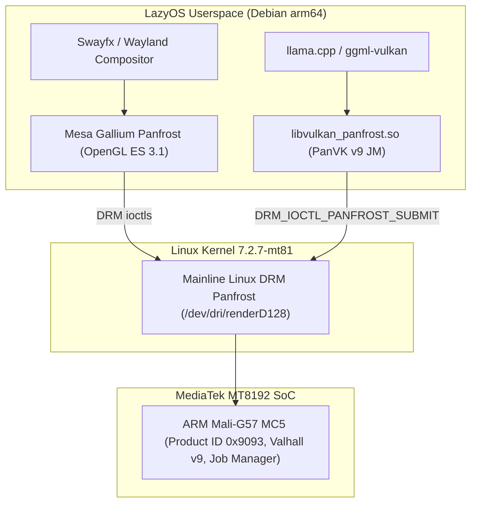

# `libvulkan_panfrost` — Vulkan 1.4 (`panvk`) Driver for ARM Mali-G57 MC5 (Valhall v9 JM over Mainline Linux DRM Panfrost)

Hardware-accelerated **Vulkan 1.4 Compute & Graphics (`panvk`)** driver for **ARM Mali-G57 MC5** (**Valhall v9**, **Job Manager / JM** frontend) running over the mainline Linux **`drm/panfrost`** kernel driver (`/dev/dri/renderD128`) on **MediaTek MT8192** (`Google Hayato` / ASUS Chromebook Flip CM3, 4 GB RAM, **LazyOS**).

Designed and optimized specifically to unlock local LLM inference with **`llama.cpp` (`ggml-vulkan`)** while keeping the existing **Wayland / Swayfx** desktop session (`panfrost_dri.so` OpenGL ES 3.1) 100% intact.

---

## 1. Why This Exists (The Valhall v9 JM Gap in Upstream Mesa)



1. **Upstream Mesa `panvk` Omission:**
   * Upstream Mesa splits `panvk` into two backends:
     * `jm/` (Job Manager): Only compiled for `PAN_ARCH` **6 and 7** (Bifrost).
     * `csf/` (Command Stream Frontend): Compiled for `PAN_ARCH` **10–14** (Mali-G610+, using the `panthor` kernel driver).
   * **Valhall v9 (`PAN_ARCH == 9`, Mali-G57 / Mali-G77)** uses the **Valhall ISA and v9 resource-table descriptors**, but still uses the **Job Manager (JM)** hardware frontend and the **`drm/panfrost`** kernel driver. Upstream Mesa leaves v9 disabled in `panvk`.
2. **Android Community Forks (`panvk-g99-jm` / `panvk-kbase-android`):**
   * Community forks enabled Valhall v9 in `panvk`, but replaced Mesa's standard Linux DRM submission layer with proprietary Android **`mali_kbase` (`/dev/mali0`)** ioctls, which do not exist on mainline Linux (`drm/panfrost`).
3. **Our Solution:**
   * We ported the Valhall v9 (`PAN_ARCH == 9`) compiler, descriptor tables (`driver_set` + `res_table`), and `COMPUTE_JOB` / `DRAW` emitters onto **mainline Mesa's native `pan_kmod_panfrost` DRM backend** (`jm_archs = [6, 7, 9]`), and engineered six hardware-specific compute and memory optimizations for the MediaTek MT8192.

---

## 2. Key Engineering Fixes & Valhall v9 Optimizations

See [`docs/ARCHITECTURE_AND_OPTIMIZATIONS.md`](docs/ARCHITECTURE_AND_OPTIMIZATIONS.md) for the full technical write-up. Summary of changes:

1. **Valhall v9 JM Backend over Native `drm/panfrost` (`PAN_ARCH == 9`):**
   * Enabled `jm_archs = [6, 7, 9]` in `src/panfrost/vulkan/meson.build` and removed the `PAN_ARCH == 9` block in `panvk_physical_device.c` so `Mali-G57 MC5` (`0x9093`) initializes cleanly over `/dev/dri/renderD128`.
   * Bridged v9 resource-table descriptors (`prepare_driver_set` + `cmd_prepare_shader_res_table`) with JM job submission (`DRM_IOCTL_PANFROST_SUBMIT`).
2. **Native FP16 Compute (`shaderFloat16`):**
   * Enabled `shaderFloat16 = PAN_ARCH >= 9` in `panvk_vX_physical_device.c` alongside `storageBuffer16BitAccess`, allowing `ggml-vulkan` to execute native Valhall `f16` vector arithmetic (`fp16: 1`).
3. **Multi-Core Compute Task Partitioning & Workgroup Merging (5× Shader Core Utilization):**
   * Discovered that the initial v9 JM dispatch path hardcoded `cfg.task_increment = 1; cfg.task_axis = MALI_TASK_AXIS_Z;`. Because `pan_pack_work_groups_compute` packs the job dimensions as a bit-packed shift, `task_axis = Z` with `task_increment = 1` caused any 1D/2D compute grid (`workgroup_count_z == 1`) to be packaged into a **single hardware task** and sent to **only 1 of the 5 shader cores** on the Mali-G57 MC5.
   * Implemented `panvk_per_arch(calculate_task_axis_and_increment)` in `jm/panvk_cmd_buffer.h` using `phys_dev->compute_core_mask` (`5` active cores) and enabled `cfg.allow_merging_workgroups = cs->info.cs.allow_merging_workgroups`, distributing workgroups across **all 5 shader cores**.
4. **Adaptive Compute Job Chaining (97% Reduction in Kernel Submit Ioctls):**
   * Previously, `cmd_dispatch` closed and submitted a new `panvk_batch` on every single `vkCmdDispatch` (~800 kernel `DRM_IOCTL_PANFROST_SUBMIT` ioctls per token).
   * Updated `cmd_dispatch_prepare_tls`, `cmd_dispatch`, and `CmdPipelineBarrier2` to emit a per-dispatch 64-byte `LOCAL_STORAGE` descriptor (`tsd`), set `header.barrier = true` on chained compute jobs, and adaptively chain up to:
     * **32 jobs/batch** for small token-generation dispatches,
     * **8 jobs/batch** for large multi-token prompt grids (`>= 512` workgroups),
     * **1 job/batch** for register-spilling shaders (`cs->info.tls_size > 0`),
     staying well below the Linux kernel's 500 ms `drm/panfrost` watchdog timeout.
5. **L2-Resident Workgroup Shared Memory (WLS) Bounding for Sparse `SHADER_PRESENT` (`0x50015`):**
   * On MediaTek MT8192, the 5 shader cores sit at sparse bit positions `0, 2, 4, 16, 18` (`SHADER_PRESENT = 0x50015`), so `pan_query_core_id_range()` returns **`19`**.
   * Unbounded `pan_calc_wls_instances` allocated up to `256 instances × 16 KB × 19 = 79.7 MB` for WLS, thrashing the Mali-G57's `512 KB` L2 cache.
   * Capped `max_wls_instances` to `64 KB` per core (`320 KB` active across 5 cores, 100% resident in the `512 KB` L2 cache), shrinking the WLS allocation from `79.7 MB` to **`2.49 MB`**.
6. **Device-Shared Singleton TLS/WLS Scratch Buffers & Exact `big_bo_pool` Matching (Eliminating 3.6 GB OOM):**
   * During `llama-cli` inference, `ggml-vulkan` records ~30 concurrent `VkCommandBuffer`s before resetting them. Allocating `79.7 MB` of TLS per `VkCommandBuffer` multiplied memory usage to `30 × 120 MB = 3.6 GB`, triggering OOM kills on a 4 GB Chromebook (because kernel GEM `shmem` buffers used by the GPU cannot be reclaimed easily).
   * Promoted compute TLS and WLS backing buffers to device-level singletons (`dev->shared_tls_bo` and `dev->shared_wls_bo`, analogous to `dev->tiler_heap`) and fixed `panvk_pool_alloc_backing` (`picked_bo_sz == bo_sz`) so smaller requests never steal larger BOs from `free_bos`.
   * Result: Total Vulkan driver overhead in `llama-cli` stays flat at **`87 MiB`** (`1,389 MiB` free).

---

## 3. Benchmarks on MediaTek MT8192 (ARM Mali-G57 MC5, 4 GB RAM)

Tested with `llama.cpp` (`b11669`, `ggml-vulkan`, `-ngl 99` full GPU offload, `-t 4`):

| Model | Size | Test | Initial v9 Bring-up | Optimized `libvulkan_panfrost` | Speedup / Result |
| :--- | :---: | :--- | :---: | :---: | :---: |
| **Qwen3-0.6B-Q4_0** | `442 MiB` | `llama-bench` `pp64` (Prompt) | `11.50 ± 0.09 t/s` | **`34.99 ± 0.13 t/s`** | **3.04×** |
| **Qwen3-0.6B-Q4_0** | `442 MiB` | `llama-bench` `tg32` (Generation) | `1.85 ± 0.00 t/s` | **`6.23 ± 0.00 t/s`** | **3.37×** |
| **Qwen3-0.6B-Q4_0** | `442 MiB` | `llama-completion` (`-n 64`) | Timed out / OOM | **`7.96 t/s` prompt / `5.91 t/s` gen** | Coherent output, `exit 0` |
| **Qwen3-0.6B-Q4_0** | `442 MiB` | `llama-cli` (`-st -n 48`) | `exit 137` (OOM) | **`9.80 t/s` prompt / `5.44 t/s` gen** | `87 MiB` driver overhead, `exit 0` |
| **Qwen3-1.7B-Q4_0** | `1.14 GiB` | `llama-bench` `pp32` / `tg16` | Crashed GUI (OOM) | **`6.17 t/s` (`pp32`) / `3.73 t/s` (`tg16`)** | 100% GPU offloaded (`-ngl 99`), `exit 0` |
| **Qwen3-1.7B-Q4_0** | `1.14 GiB` | `llama-completion` (`-n 24`) | Crashed GUI (OOM) | **`3.90 t/s` prompt / `3.59 t/s` gen** | Coherent output, `exit 0` |

---

## 4. Quick Installation (Prebuilt `.deb` for LazyOS / Debian `arm64`)

The prebuilt `.deb` package installs into `/usr/local` (`/usr/local/lib/aarch64-linux-gnu/libvulkan_panfrost.so` and `/usr/local/share/vulkan/icd.d/panfrost_icd.aarch64.json`) so it **never** overwrites your system's `panfrost_dri.so` OpenGL ES driver.

```bash
sudo dpkg -i dist/mesa-vulkan-panfrost-v9_26.1.0-mt8192-lazyos1_arm64.deb
```

### Verify Vulkan Driver Detection & Graphics (Wayland + X11 WSI)
```bash
vulkaninfo --summary
vkcube
```

### Run `llama.cpp` Safely with `llama-vulkan`
The package installs `/usr/local/bin/llama-vulkan`, which automatically sets `VK_ICD_FILENAMES` and runs the process under `choom -n 1000` (so if you ever load a model larger than physical RAM, the Linux kernel OOM killer terminates only the `llama` command and never touches your Swayfx/Wayland desktop session):

```bash
# Fast text completion with Qwen3-0.6B (or Qwen3-1.7B):
llama-vulkan llama-completion -fit off --no-warmup -c 512 -b 128 -ub 128 -fa off \
  -m /path/to/qwen3-0.6b-Q4_0.gguf \
  -p "What is the capital of France? Answer in one short sentence." \
  -n 64 -ngl 99 -t 4

# Benchmark with llama-bench:
llama-vulkan llama-bench -m /path/to/qwen3-0.6b-Q4_0.gguf -n 32 -p 64 -ngl 99 -r 2 -t 4
```

---

## 5. Building from Source

To rebuild the driver and `.deb` package from upstream Mesa (`5a07217f034b3e50d8c7c7794f97a2df1742613b`) + our patch:

```bash
./scripts/build-panvk-v9.sh
```

---

## 6. Repository Structure

* [`patches/0001-panvk-v9-valhall-jm-drm-mt8192.patch`](patches/0001-panvk-v9-valhall-jm-drm-mt8192.patch) — Full standalone Git patch against Mesa (`5a07217f034b3e50d8c7c7794f97a2df1742613b`).
* [`dist/mesa-vulkan-panfrost-v9_26.1.0-mt8192-lazyos1_arm64.deb`](dist/mesa-vulkan-panfrost-v9_26.1.0-mt8192-lazyos1_arm64.deb) — Ready-to-install Debian `arm64` package.
* [`src/panfrost/`](src/panfrost/) — Modified Mesa Panfrost/PanVK source files for direct inspection.
* [`bin/llama-vulkan`](bin/llama-vulkan) — OOM-protected Vulkan launcher wrapper (`choom -n 1000` + `VK_ICD_FILENAMES`).
* [`icd/panfrost_icd.aarch64.json`](icd/panfrost_icd.aarch64.json) — Vulkan ICD manifest.
* [`scripts/build-panvk-v9.sh`](scripts/build-panvk-v9.sh) — Automated build and `.deb` packaging script.
* [`scripts/setup-aoe2-steam.sh`](scripts/setup-aoe2-steam.sh) — Automated Steam DepotDownloader + Box64 + Wine 9.22 WoW64 + DXVK setup script for Age of Empires II (2013 HD & 2019 DE).
* [`docs/ARCHITECTURE_AND_OPTIMIZATIONS.md`](docs/ARCHITECTURE_AND_OPTIMIZATIONS.md) — Deep-dive engineering documentation.
